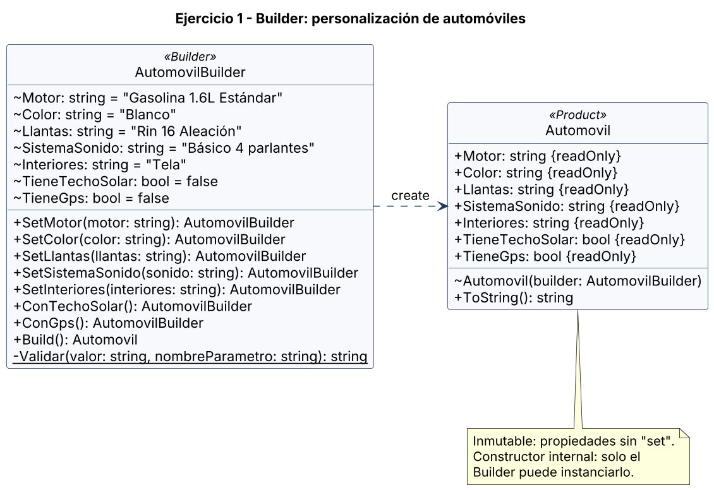
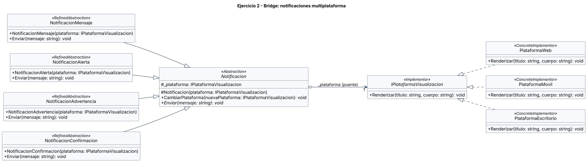
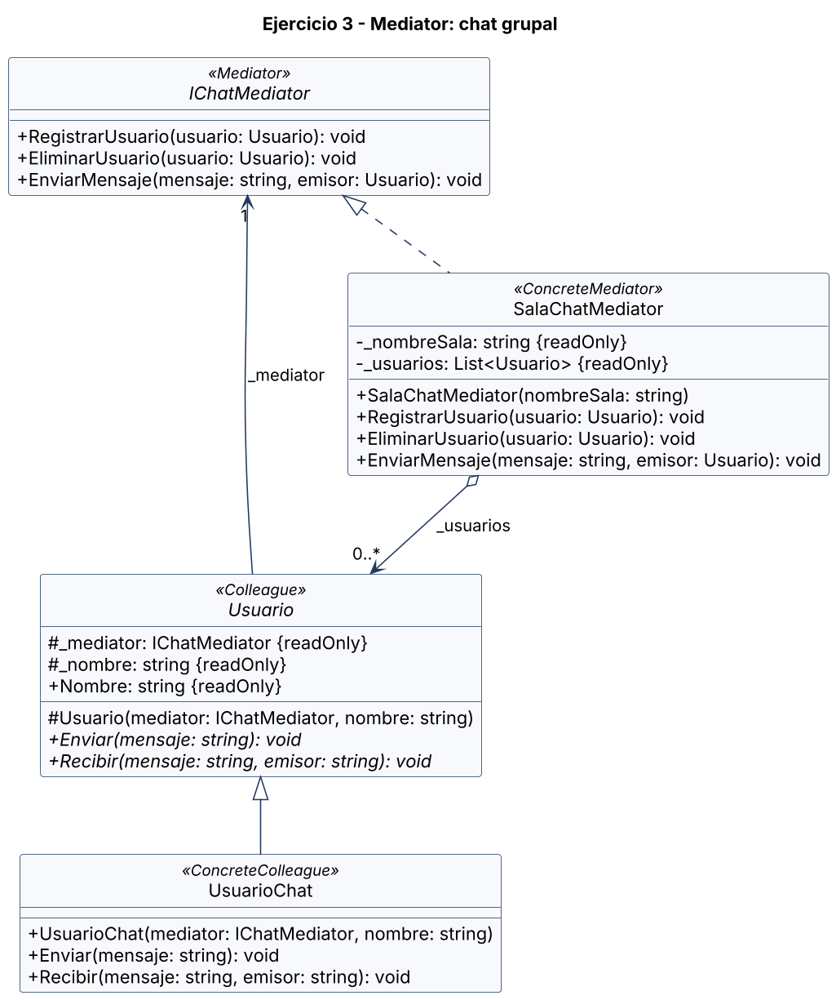

# Actividad 1 – Patrones de Diseño (GoF) en C#

**Universidad de La Sabana · Maestría en Arquitectura de Software · Arquitectura de Software EFIN 2026-6 · Grupo 2**

Integrantes: Leonardo Fabio Jejen · Camilo Esteban Gomez · Cristian Eduardo Vargas

Este repositorio resuelve los tres escenarios de la actividad con un patrón de cada categoría GoF. Los tres están implementados en un único lenguaje (C#) dentro de una sola aplicación de consola, y cada diagrama de clases UML coincide 1:1 con el código.

| # | Escenario | Categoría | Patrón | Código | Diagrama |
|---|-----------|-----------|--------|--------|----------|
| 1 | Personalización de automóviles | Creacional | **Builder** | [`Ejercicio1_Builder/`](src/Actividad1Patrones/Ejercicio1_Builder) | [png](docs/diagramas/ejercicio1-builder.png) · [puml](docs/diagramas/ejercicio1-builder.puml) · [drawio](docs/diagramas/ejercicio1-builder.drawio) |
| 2 | Notificaciones multiplataforma | Estructural | **Bridge** | [`Ejercicio2_Bridge/`](src/Actividad1Patrones/Ejercicio2_Bridge) | [png](docs/diagramas/ejercicio2-bridge.png) · [puml](docs/diagramas/ejercicio2-bridge.puml) · [drawio](docs/diagramas/ejercicio2-bridge.drawio) |
| 3 | Chat grupal | Comportamiento | **Mediator** | [`Ejercicio3_Mediator/`](src/Actividad1Patrones/Ejercicio3_Mediator) | [png](docs/diagramas/ejercicio3-mediator.png) · [puml](docs/diagramas/ejercicio3-mediator.puml) · [drawio](docs/diagramas/ejercicio3-mediator.drawio) |

La identificación y justificación completa de cada patrón (atributos de calidad, trade-offs y alternativas descartadas) está en [docs/justificacion.md](docs/justificacion.md).

## Cómo ejecutar

Requiere el SDK de .NET 10.

```bash
git clone <url-del-repositorio>
cd <carpeta-del-repositorio>
dotnet run --project src/Actividad1Patrones          # los tres ejercicios
dotnet run --project src/Actividad1Patrones -- 2     # solo un ejercicio (1, 2 o 3)
```

También se puede abrir `Actividad1Patrones.sln` en Visual Studio, Rider o VS Code y ejecutar con F5. La salida esperada está en [docs/evidencia/salida-consola.txt](docs/evidencia/salida-consola.txt).

## Estructura del repositorio

```
├── Actividad1Patrones.sln
├── src/Actividad1Patrones/
│   ├── Program.cs                  Punto de entrada único que ejecuta los tres escenarios
│   ├── Ejercicio1_Builder/         Automovil, AutomovilBuilder
│   ├── Ejercicio2_Bridge/          Notificacion (+4 tipos), IPlataformaVisualizacion (+3 plataformas)
│   └── Ejercicio3_Mediator/        IChatMediator, SalaChatMediator, Usuario, UsuarioChat
└── docs/
    ├── justificacion.md            Identificación y justificación de los tres patrones
    ├── diagramas/                  Un diagrama por ejercicio en .puml, .png, .svg y .drawio
    └── evidencia/                  Salida de consola de la ejecución
```

Cada ejercicio vive en su propio namespace (`Ejercicio1_Builder`, `Ejercicio2_Bridge`, `Ejercicio3_Mediator`) y cada clase en su propio archivo, con el mismo nombre que tiene en el diagrama.

## Ejercicio 1 – Builder: personalización de automóviles



`AutomovilBuilder` acumula las opciones con una interfaz fluida y trae valores de fábrica, de modo que el cliente solo indica lo que quiere cambiar. `Automovil` es inmutable: sus propiedades no tienen `set` y su constructor es `internal`, así que solo el builder puede crearlo.

```csharp
Automovil auto = new AutomovilBuilder()
    .SetMotor("Híbrido Turbo 2.5L")
    .SetInteriores("Cuero Nappa")
    .ConTechoSolar()
    .Build();
```

## Ejercicio 2 – Bridge: notificaciones multiplataforma



Los cuatro tipos de notificación (mensaje, alerta, advertencia, confirmación) y las tres plataformas (web, móvil, escritorio) son jerarquías independientes unidas por la referencia `_plataforma`. Son 4 + 3 clases en lugar de 4 × 3, y la plataforma se puede cambiar en tiempo de ejecución con `CambiarPlataforma`.

```csharp
Notificacion alerta = new NotificacionAlerta(new PlataformaWeb());
alerta.Enviar("Uso de CPU al 95%.");
alerta.CambiarPlataforma(new PlataformaMovil());
alerta.Enviar("Uso de CPU al 95%.");
```

## Ejercicio 3 – Mediator: chat grupal



Ningún `Usuario` conoce a otro: todos hablan con `IChatMediator`. `SalaChatMediator` administra los miembros y reparte cada mensaje a todos menos al emisor, por lo que agregar o retirar usuarios no afecta a los demás.

```csharp
IChatMediator sala = new SalaChatMediator("Grupo 2");
Usuario leonardo = new UsuarioChat(sala, "Leonardo");
sala.RegistrarUsuario(leonardo);
leonardo.Enviar("Hola equipo");
```

## Convenciones de los diagramas

Los tipos son los nativos de C# (`string`, `bool`, `void`). La visibilidad sigue UML: `+` public, `#` protected, `-` private y `~` internal (ensamblado). `{readOnly}` marca propiedades sin `set` y campos `readonly`; la cursiva marca clases y operaciones abstractas; el subrayado, miembros estáticos. Los estereotipos (`«Builder»`, `«Abstraction»`, `«Mediator»`…) indican el rol de cada clase en el patrón GoF.

Los archivos `.puml` son la fuente de los `.png` y `.svg`. Los `.drawio` contienen el mismo diagrama con figuras editables para ajustarlo en [diagrams.net](https://app.diagrams.net).

## Referencias

Bass, L., Clements, P., & Kazman, R. (2021). *Software architecture in practice* (4th ed.). Addison-Wesley Professional.

Gamma, E., Helm, R., Johnson, R., & Vlissides, J. (1994). *Design patterns: Elements of reusable object-oriented software*. Addison-Wesley.

International Organization for Standardization. (2011). *Systems and software engineering — Systems and software Quality Requirements and Evaluation (SQuaRE) — System and software quality models* (ISO/IEC 25010:2011).
